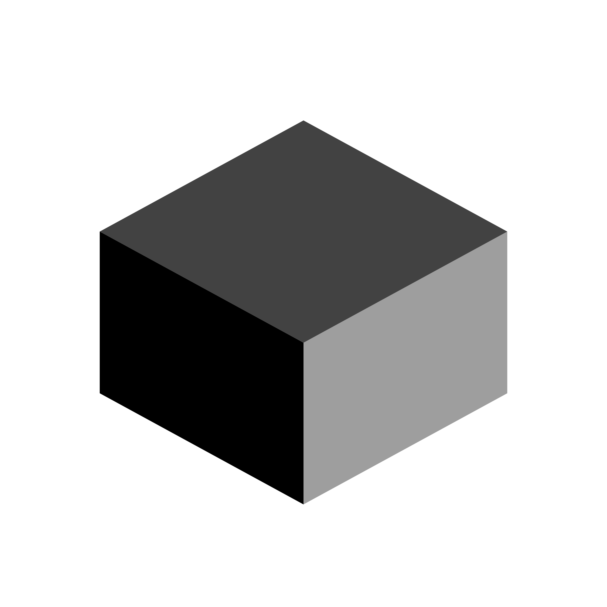

<H1 align="center">Cubic Launcher</H1>




* Cubic is a launcher, based on [PojavLauncher](https://github.com/PojavLauncherTeam/PojavLauncher), [MojoLauncher](https://github.com/MojoLauncher/MojoLauncher), and [CopperLauncher](https://github.com/CubicLauncher/Cubic-Android), that allows you to play Minecraft: Java Edition on your Android device!

* It can run almost every version of Minecraft, allowing you to use .jar only installers to install modloaders such as [Forge](https://files.minecraftforge.net/) and [Fabric](http://fabricmc.net/) and mods like [OptiFine](https://optifine.net).

## Navigation
- [Introduction](#introduction)
- [Getting Cubic](#getting-mojolauncher)
- [Building](#building) 
- [Current roadmap](#current-roadmap) 
- [License](#license) 
- [Contributing](#contributing) 
- [Credits & Third party components and their licenses](#credits--third-party-components-and-their-licenses-if-available)

## Introduction 
* Cubic is a Minecraft: Java Edition launcher for Android based on [PojavLauncher](https://github.com/PojavLauncherTeam/PojavLauncher) & [MojoLauncher](https://github.com/MojoLauncher/MojoLauncher)
* This launcher can launch almost all available Minecraft versions ranging from rd-132211 to 26.x snapshots (including Combat Test versions). 
* Modding via Forge and Fabric are also supported. 

## Getting Cubic

You can get Cubic via four methods:

1. You can get the prebuilt app from the [releases section](https://github.com/nanowx26/Cubic-Launcher/releases/).

2. You can get early builds from [Github Actions](https://github.com/nanowx26/Cubic-Launcher/actions).

3. You can [build](#building) from source.
## Building   
* Build the launcher (it will automatically download all required components)
```
./gradlew :app_mojo:assembleDebug
```
If you are building on Windows:
* Replace `./gradlew` with `.\gradlew.bat`
* Make sure `mojoexec`, `sdl`, `glfw` are symlinked into `app_mojo/src/main/jni/`

## License
- Cubic is licensed under [GNU LGPLv3](https://github.com/nanowx26/Cubic-Launcher/blob/v3_openjdk/LICENSE).

## Contributing
Contributions are welcome! We appreciate any type of contribution, not only code. For example, you can help the wiki shape up. You can help the [translation](https://mojolauncher.ru/translate/translator.html) too!


Any code change to this repository should be submitted as a pull request. The description should explain what the code does and give steps to execute it.

## Third party components, licenses and sources (when applicable)
- [CopperLauncher](https://github.com/CopperLauncher/Copper-Android): [GNU LGPLv3 License](https://github.com/CopperLauncher/Copper-Android/blob/v3_openjdk/LICENSE)
- [PojavLauncher](https://github.com/PojavLauncherTeam/PojavLauncher): [GNU LGPLv3 License](https://github.com/PojavLauncherTeam/PojavLauncher/blob/v3_openjdk/LICENSE)
- [MojoLauncher](https://github.com/MojoLauncher/MojoLauncher): [GNU LGPLv3 License](https://github.com/MojoLauncher/MojoLauncher/blob/v3_openjdk/LICENSE)
- [Pojav-Reborn](https://github.com/TeamPojavLauncher/PojavLauncher): [GNU LGPLv3 License](https://github.com/TeamPojavLauncher/PojavLauncher/blob/v3_openjdk/LICENSE)
- [PGW](https://github.com/Vera-Firefly/Pojav-Glow-Worm): [GPL-3 License](https://github.com/Vera-Firefly/Pojav-Glow-Worm/blob/main_v3/LICENSE)
- Android Support Libraries: [Apache License 2.0](https://android.googlesource.com/platform/prebuilts/maven_repo/android/+/master/NOTICE.txt).
- [Holy GL4ES](https://github.com/artdeell/gl4es_extra_extra/): [MIT License](https://github.com/ptitSeb/gl4es/blob/master/LICENSE).<br>
- [OpenJDK](https://github.com/PojavLauncherTeam/openjdk-multiarch-jdk8u): [GNU GPLv2 License](https://openjdk.java.net/legal/gplv2+ce.html).<br>
- [MobileGlues](https://github.com/MobileGL-Dev/MobileGlues): [LGPL-2.1 License](https://github.com/MobileGL-Dev/MobileGlues/blob/main/LICENSE)
- [SFPEW](https://github.com/MobileGL-Dev/SimpleFPEWrapper): [GNU LGPLv3 License](https://github.com/MobileGL-Dev/SimpleFPEWrapper/blob/main/LICENSE)
- [GLFW](https://github.com/MojoLauncher/glfw): [zlib license](https://github.com/MojoLauncher/glfw/blob/glfw34/LICENSE.md)
- [SDL](https://github.com/MojoLauncher/MojoSDL): [zlib license](https://github.com/MojoLauncher/MojoSDL/blob/main/LICENSE.txt)
- [LWJGL2-GLFW](https://github.com/MojoLauncher/lwjgl2-glfw): 3-Clause BSD license
- [LWJGL3](https://github.com/LWJGL/lwjgl3): [BSD-3 License](https://github.com/LWJGL/lwjgl3/blob/master/LICENSE.md).
- [mojoexec](https://github.com/MojoLauncher/mojoexec): [MIT License](https://github.com/MojoLauncher/mojoexec/blob/master/LICENSE)
- [Mesa 3D Graphics Library](https://gitlab.freedesktop.org/mesa/mesa): [MIT License](https://docs.mesa3d.org/license.html).
- [pro-grade](https://github.com/pro-grade/pro-grade) (Java sandboxing security manager): [Apache License 2.0](https://github.com/pro-grade/pro-grade/blob/master/LICENSE.txt).
- [Authlib-Injector](https://github.com/yushijinhun/authlib-injector) (Used for authorisation via ely.by): [AGPL-3.0](https://github.com/yushijinhun/authlib-injector/blob/develop/LICENSE).
- [alsoft](https://github.com/kcat/openal-soft/) (Audio output library): [GNU Library General Public License](https://github.com/kcat/openal-soft/blob/master/COPYING) and [Modified PFFFT](https://github.com/kcat/openal-soft/blob/master/LICENSE-pffft).
- [oboe](https://github.com/google/oboe): [Apache License 2.0](https://github.com/google/oboe/blob/main/LICENSE).
- Thanks to [Mineskin](https://mineskin.eu/) for providing Minecraft avatars.

## Special thanks
- Thanks to [MojoLauncher](https://github.com/MojoLauncher/MojoLauncher/) for the android icons, Made by [Yarpopcat08](https://github.com/Yarpopcat08).
- Thanks to [whynelo](https://github.com/whynelo) for the new cubic icons.